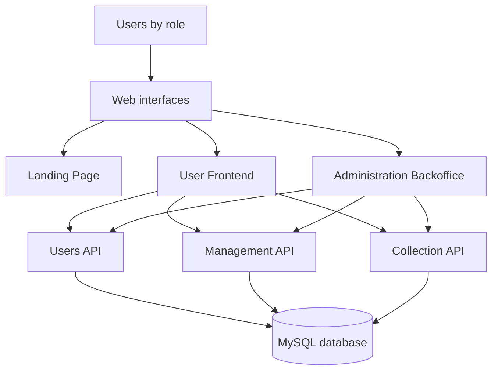

# System Overview — DataByte / SiGeRU

**Collaborative academic software project | Escuela Superior de Informática (UTU), Uruguay | 2026**

## 1. Project background

**SiGeRU** stands for *Sistema de Gestión de Residuos Urbanos* (Urban Waste Management System). **DataByte** is the name of the academic team/project and its web platform. The system was designed to support municipal waste-collection operations by connecting administrative staff and field workers.

The problem addressed in the project documentation is the difficulty of coordinating containers, collection vehicles, routes, incidents, crews, and waste-reception facilities. The intended benefits include improved incident follow-up, resource coordination, and access to operational information.

**Scope clarification:** This page summarizes the system described in the team's academic documentation. It does not assert that every specified capability was fully implemented, released, or tested successfully. This repository presents selected historical QA evidence, not a live product demonstration.

## 2. Intended users and access roles

| Role in source documentation | Purpose / permitted work described |
| --- | --- |
| **Technical Administrator** (*Administrador Técnico*) | Administrative management of users, roles, resources and system operations; also responsible for technical infrastructure in the requirements description. |
| **Municipal Inspector** (*Inspector Municipal*) | Supervise collection operations and consult/manage route and vehicle information. |
| **Collection Crew Operator** (*Operario de Cuadrilla*) | Consult assigned routes and record incidents detected during collection. |
| **Facility Operator** (*Operario de Establecimiento / centro de acopio*) | Consult facility capacity and conditions; record received waste and relevant machinery updates. |

The system requirements call for authentication and **role-based access control (RBAC)**. Different roles should only see or access the functions assigned to them. This makes authentication and authorization key QA areas.

## 3. Functional areas in the requirements

The original specification groups intended capabilities into the following areas:

1. **Users and permissions:** registration, administrative approval or rejection, role management, login and password changes.
2. **Containers and incidents:** container records, locations and status; reporting and tracking issues such as damage, overflow or missed collection.
3. **Collection operations:** routes, crews, collection vehicles and assignments.
4. **Facilities and equipment:** waste-reception establishments, machinery, maintenance and intake/unloading records.
5. **Monitoring and reports:** operational listings, statistics and administrative views.

These are *specified system capabilities*. For example, route registration and truck assignment were expected for the Municipal Inspector, but the original **CN-046** black-box test reported that those options were unavailable from the Inspector interface (**Fail**). The available documents do not confirm a subsequent fix or retest.

## 4. Documented software architecture

The integrator describes multiple independent web components, separated into user interfaces, REST-style APIs and a relational database:

*Conceptual diagram derived from the documented component list; not an independently verified deployment topology or exhaustive diagram of actual call paths.* The specification also allows direct Backoffice-to-database access for certain administrative operations, which is omitted from this simplified diagram.

### Documented technology choices

| Layer / activity | Technology in academic documentation |
| --- | --- |
| Web interfaces | HTML5, CSS3, JavaScript |
| Server-side / APIs | PHP 8, REST-style HTTP/JSON |
| Application structure | MVC, separate application codebases |
| Database | MySQL 8; the local test plan also mentions MySQL/MariaDB |
| Target server platform | Rocky Linux 8 Minimal |
| Container deployment | Docker; described as an architectural/deployment requirement |
| Version control / collaboration | Git, GitHub |
| Interface prototyping | Figma |
| API validation | Postman |
| Planning and coordination | Trello, Discord and team communication |

**Requirement vs. verification:** Docker isolation, cross-platform portability, HTTPS and non-functional targets are documented as design requirements. This portfolio does not claim they were all independently validated.

## 5. System boundaries

The original scope explicitly **excludes** physical or chemical waste treatment, payment/financial processing, and integration with pre-existing third-party municipal platforms. Advanced recycling and automated fill-level predictions are listed as potential future improvements, not mandatory functionality.

This boundary matters in QA: a test should verify a committed requirement, rather than assuming a proposed future feature already exists.

## 6. Quality assurance focus

The team documentation provides the following historical QA artifacts:

| Evidence type | Coverage in the documentation | Portfolio location |
| --- | --- | --- |
| Black-box functional testing | 53 cases, `CN-001`–`CN-053`, with recorded outcomes | [`../testing/black-box-testing.md`](../testing/black-box-testing.md) |
| Detailed test cases | 125 cases, `CP-001`–`CP-125` | [`../testing/test-cases.md`](../testing/test-cases.md) |
| Test data | 125 associated identifiers, `JD-001`–`JD-125` | [`../testing/test-data.md`](../testing/test-data.md) |
| White-box test design | Five PHP `Usuario` methods analyzed through control-flow and paths | [`../testing/white-box-testing.md`](../testing/white-box-testing.md) |
| API validation | 11 Postman `POST` creation tests; HTTP `201 Created` recorded | [`../testing/api-testing.md`](../testing/api-testing.md) |

The `CN`, `CP` and `JD` identifiers come from the team's original documents. The API portfolio reference numbers `API-01`–`API-11` are navigation labels assigned in this portfolio, not identifiers in the original report.

### Illustrative integration of QA perspectives

- **API layer:** the documented create-route request returned `HTTP 201 Created` in Postman (API portfolio reference `API-10`).
- **User interface layer:** `CN-046` recorded that a Municipal Inspector could view route information but could not access route registration or truck-assignment functions (**Fail**).

These observations concern **different interfaces and scopes**. A successful backend request does not establish that the intended end-user workflow is available or authorized correctly.

## 7. Evidence and attribution policy

This is a **collaborative DataByte team project**. Historical tests and documentation are attributed to the team rather than to any individual contributor.

- Recorded `Pass` and `Fail` statuses are transcribed from academic documents; they are not independent reruns.
- The stated 100% white-box coverage in the integrator is not represented as coverage measured with an independent tool.
- Some test datasets contain placeholders or inconsistent role/input values; those gaps remain visible in the curated testing documentation.
- No verified fix or retest has been supplied for `CN-046`.
- Original PDFs, credentials, internal addresses, student identity numbers and other sensitive material are not published here. Team permission and a security review are prerequisites before making any repository public.

## 8. Source references

- **DataByte — Documento Integrador, Tercera Entrega (2026):** introduction and scope (printed pages 6–8); functions and roles (printed pages 13–16); functional and non-functional requirements (printed pages 17–26); technical procedures and technologies (printed page 35); API tests (printed pages 139–150); testing plan and white-box material (printed pages 158–208); test cases and data (printed pages 210–326).
- **Caja Negra DataByte (5 November 2026):** independent functional test records `CN-001`–`CN-053`, including failed case `CN-046`.

The source PDFs are **not included in this public-oriented portfolio**. Page numbers refer to the printed numbering in the integrator; the PDF viewer may show the next page number.
